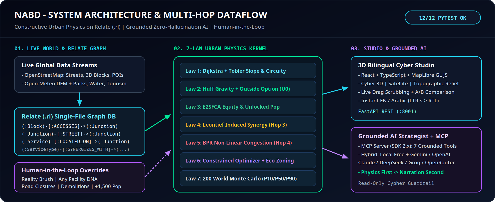
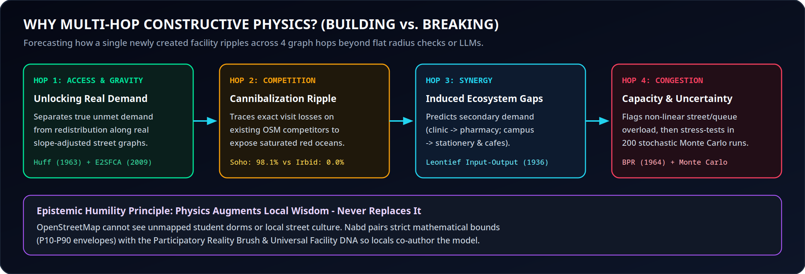
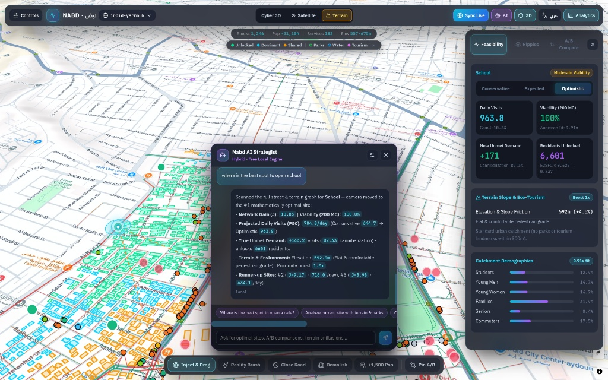

# NABD (نبض) — Constructive Urban Physics & Multi-Hop Spatial Simulation

> **Forecasting cities by building, not only by breaking.**
> A real-time 3D urban physics studio, `Relate` graph engine, and grounded AI strategist that simulates how injecting **any** new business or public facility ripples across real street topologies, terrain slopes, ecosystems, and competing services.



---

## 1. The Core Thesis: Why Constructive Forecasting?

Many graph-database and resilience tools focus predominantly on **destructive cascades** — asking what fails when a road is severed, a bridge collapses, or a node is removed. While stress-testing failure matters (and Nabd includes a full live crisis sandbox for road closures and building demolitions), cities are primarily shaped by **constructive decisions**: *What happens to a neighborhood's living equilibrium when we build a clinic, open a barber shop, launch a bakery, or introduce a padel court?*

Answering that question rigorously is impossible with flat straight-line radius circles or generic LLM prompting. A new facility does not exist in a vacuum — it triggers a **4-hop graph cascade**:

1. **Hop 1 — Access & Gravity:** Who can actually walk there along real streets and real elevation slopes, and is that demand *genuinely new* or merely pulled from existing neighbors?
2. **Hop 2 — Competitive Cannibalization:** Which specific existing businesses lose visits, and by what percentage?
3. **Hop 3 — Induced Ecosystem Synergy:** What secondary demand deficits does the new facility *create* around it (e.g., a clinic inducing pharmacy demand, or a campus hub inducing stationery and cafe deficits)?
4. **Hop 4 — Congestion & Uncertainty:** At what load does the facility or adjacent street hit non-linear queuing/traffic delay, and how robust is the site across 200 stochastic worlds?



---

## 2. Epistemic Humility & Human-in-the-Loop Design

No spatial model knows everything about a street. OpenStreetMap data is remarkably rich in cities like London (`698` mapped services in a 400m Soho radius), yet can miss newly opened shops, unmapped student dormitories, informal commercial corridors, rent economics, or cultural nuances in rapidly growing cities.

Nabd is built around **epistemic humility**: mathematical physics should **amplify local human judgment, never pretend to replace it**. That principle is engineered directly into three core mechanics:

* **Uncertainty Envelopes, Never False Point-Precision:** Instead of outputting a single misleading forecast, every injection runs **200 Monte Carlo worlds** varying population density, distance sensitivity ($\beta$), and attraction to report **Conservative (P10)**, **Expected (P50)**, and **Optimistic (P90)** scenarios alongside a viability probability.
* **Participatory Reality Brush (Local Knowledge Injection):** People who live on the ground know where female student housing, family neighborhoods, or commercial youth hubs actually sit. With the **Reality Brush**, users paint local demographic truth directly onto 3D blocks and watch the equations recalibrate in milliseconds.
* **Universal Facility DNA Synthesizer (Freedom to Model Anything):** Real entrepreneurs are not limited to 11 preset categories. Users can type **any facility in Arabic or English** (*Padel Court, Shawarma Restaurant, Women's Gym, Dental Clinic, Coworking Space, Car Wash...*), synthesize its grounded economic physics (distance decay, daily capacity, 6-segment audience profile, time-of-day rhythm, and real OSM competitor mapping), fine-tune every slider, and run Law 6 spatial optimization across the entire city graph.

---

## 3. The 7 Laws of Urban Physics (Equations & Scientific Heritage)

Every calculation inside `backend/engine/physics.py` and `backend/engine/terrain_env.py` is grounded in established urban-economics and operations-research models rather than heuristic guesses:

| Law | Phenomenon Modeled | Scientific Pioneers | Mathematical Formulation in Nabd |
| :--- | :--- | :--- | :--- |
| **Law 1** | **Topological Accessibility, Circuity & Asymmetric Terrain Slope** | **Edsger W. Dijkstra** (1959) · **Waldo R. Tobler** (1993) | Real directed street-graph shortest paths weighted by Tobler's hiking speed ratio normalized to flat ground: $r(s) = \exp\!\left(-3.5\left(\lvert s + 0.05\rvert - 0.05\right)\right)$, where uphill slopes penalize pedestrian reach more than gentle downhills. Exposes **Topological Illusions** where circuity $CI = d_{\text{network}} / d_{\text{euclid}} \ge 1.6$. |
| **Law 2** | **Competitive Spatial Gravity & Outside Option** | **William J. Reilly** (1931) · **David L. Huff** (1963) | $$P_{ij} = \frac{A_j^\alpha \, T_{ij}^{-\beta}}{\sum_{k} A_k^\alpha \, T_{ik}^{-\beta} + U_0}$$ Including the outside option $U_0$ allows Nabd to cleanly separate **new unmet demand captured** from **competitor cannibalization**. |
| **Law 3** | **Spatial Equity & Floating Catchment Supply-Demand (E2SFCA)** | **John Radke & Lan Mu** (2000) · **Wei Luo & Yi Qi** (2009) | Two-step floating catchment with Gaussian decay $W(t)=\exp(-(t/t_{\text{ideal}})^2)$ measuring supply-to-demand ratio $R_j = C_j / \sum_i D_i W_{ij}$ and spatial equity $E_i = \sum_j W_{ij} R_j$ before and after injection, plus exact count of residents newly unlocked within ideal walking time. |
| **Law 4** | **Multi-Hop Induced Inter-Sectoral Synergy (Hop 3)** | **Wassily Leontief** (1936; Nobel Prize 1973) | Traverses `(:ServiceType)-[:SYNERGIZES_WITH]->(:ServiceType)` edges in `Relate` to compute cross-category induced visits $D^{\text{ind}}_b = 0.65 \, V_a \, m_{a \to b}$ minus distance-decayed nearby spare capacity $\sum_s 0.35 C_s e^{-\gamma t_s}$, flagging emerging secondary deficits. |
| **Law 5** | **Non-Linear Capacity & Street Congestion (Hop 4)** | **U.S. Bureau of Public Roads — BPR** (1964) | $$t_{\text{eff}} = t_0 \left[1 + 0.15 \left(\frac{V}{C}\right)^4\right]$$ Captures sharp non-linear queuing and adjacent-street delay spikes once utilization crosses $85\%\text{–}90\%$. |
| **Law 6** | **Constrained Spatial Optimization & Eco-Zoning Guardrails** | **Alfred Weber** (1909) · **S. Louis Hakimi** (1964) | Scans candidate junctions to maximize composite network gain $J$ while strictly penalizing/excluding restricted zoning polygons (**waterways, wetlands, public parks, cemeteries**) and applying proximity multipliers for **parks, waterfronts, tourism landmarks, recreation hubs, universities, and schools** (with an amplified bonus for food & hospitality venues, and a penalty near heavy industrial zones). |
| **Law 7** | **Stochastic Uncertainty & Viability Envelope** | **Stanislaw Ulam, John von Neumann & Nicholas Metropolis** (1940s) | Runs $N=200$ perturbed worlds sampling population ($\sigma=14\%$), decay ($\sigma=0.22$), and attraction ($\sigma=15\%$) to emit **P10 / P50 / P90** bounds and viability probability. |

---

## 4. Empirical Contrasts (Measured Live — Not Invented)

To verify that Nabd distinguishes genuine urban gaps from saturated traps, here are two real runs captured directly from the engine:

| Metric | Case A: Saturated Red Ocean (**Soho, London** · 400m) | Case B: Constructive Blue Ocean (**Yarmouk District, Irbid** · 750m) |
| :--- | :--- | :--- |
| **Graph Scale (`Relate`)** | `1,561` 3D blocks · `~37,557` est. pop · `698` OSM services | `1,246` 3D blocks · `~31,184` est. pop · `182` OSM services |
| **Injected Facility** | Men's Barber (`Standard Scale`, Midday) | Custom Synthesized **Padel Court** ($\beta=0.95$, Cap `120`/day) |
| **Projected Daily Visits (P50)** | `24.1` visits/day | `208.5` visits/day *(exceeds 1-court cap → signals room for 2+ courts)* |
| **New Unmet Demand Captured** | **`+0.5`** visits/day | **`+208.5`** visits/day |
| **Competitor Cannibalization** | **`98.1%`** *(red-ocean price war)* | **`0.0%`** *(pure blue-ocean gap)* |
| **Residents Newly Unlocked** | `0` (`E2SFCA: 1.278 → 1.288`) | **`19,214`** (`E2SFCA: 0 → 0.473`) |
| **Terrain & Proximity Context** | `38m` elevated ridge (`+7.3%` uphill friction) · Campus `+7.5%` | Flat grade · University Campus Hub (`+9.5%`, Boost `1.095x`) |
| **Composite Network Gain ($J$)** | **`-20.53`** — *Saturated / Weak* | **`+154.26`** — *Strong Prime Site (`100%` MC Viability)* |

### Live Studio Visual Highlights

| Zero-Clash 3-Tier Gravity Wave (Unlocked · Dominant · Shared) | Universal Facility DNA — Blue Ocean (Custom Padel Court) |
| :---: | :---: |
|  |  |
| **Holographic Satellite Roofs & Eco-Proximity Boost** | **Topographic Terrain & Grounded AI Strategist (Optimal School Site)** |
|  |  |  |

---

## 5. Grounded Multi-Hop AI: `MCP Server` + Universal Hybrid Strategist

Standard LLMs cannot compute shortest paths on a 1,000-junction street graph or evaluate coupled Huff–E2SFCA–BPR integrals — when asked *"Where should I open a cafe?"*, they guess. Nabd enforces a strict **Physics-First, Language-Second** architecture:

1. **In-App Universal Hybrid Strategist (`/api/area/{slug}/chat`):**
   * Works immediately **locally for free with zero API key**, executing the 7 Laws, flying the 3D camera to optimal sites, and briefing the user from verified metrics.
   * Plug-and-play universal router supporting **Google Gemini, OpenAI, Anthropic Claude, DeepSeek, Groq, OpenRouter, and Custom/Ollama endpoints** — injecting `GROUND_TRUTH_PHYSICS` into every turn so the model narrates and advises without hallucinating a single figure.
2. **Model Context Protocol Server (`backend/mcp/server.py`, MCP SDK 2.x):**
   Exposes **7 grounded tools** to any MCP-compatible agent (Claude Desktop, Cursor, VS Code):
   * `list_areas_and_services` · `sync_live_area` · `simulate_urban_injection` · `detect_topological_illusions` · `find_optimal_sites` · `compare_two_locations` · `run_relate_cypher_readonly` (strict regex guardrail blocking all write operations).

```json
{
  "mcpServers": {
    "nabd-urban-physics": {
      "command": "/path/to/nabd/.venv/bin/python",
      "args": ["-m", "backend.mcp.server"],
      "cwd": "/path/to/nabd"
    }
  }
}
```

---

## 6. Key Studio Features

* **Global Live Sync (Any City on Earth):** Search any city (`Manhattan`, `London`, `Tokyo`, `Amman`, `Irbid`), choose a capture radius (`400m` to `2.5km`), and build a fresh single-file `Relate (.rl)` graph with live streets, 3D buildings, DEM elevations, and environmental zones.
* **Three Purpose-Built Map Modes:**
  1. **Cyber 3D:** Extruded buildings with zero-clash color encoding (*Midnight Indigo* neutral, *Neon Emerald* unlocked, *Laser Cyan* dominant $\ge 25\%$, *Amber Gold* shared competition $6\text{–}25\%$, *Crimson* demolished).
  2. **Satellite Hologram:** High-resolution satellite imagery with translucent roof footprints and neon borders so real roofs, trees, and streets remain unobscured.
  3. **Topographic Terrain:** Relief map with clean bilingual street labels and street segments dynamically colored by real elevation slope gradient.
* **Live Drag Scrubbing & A/B Site Comparison:** Drag the glowing cyan beacon meter-by-meter along any street to watch ripples and KPIs update live, or pin **Site A** to compare head-to-head against **Site B**.
* **Live Reality Sandbox:** Paint demographic zones, close roads/junctions, demolish 3D blocks, or drop `+1,500` population surges on the fly.
* **Full Bilingual UI (`EN / العربية`):** Instant 1-click switch between English (`LTR`) and Arabic (`RTL`) across all panels, legends, terrain labels, and AI responses.

---

## 7. Quick Start & Automated Verification

### Prerequisites
* Python `3.11+`, Node.js `20+`, and the `relate` CLI binary on your `PATH`.

### Installation & One-Command Launch
```bash
git clone <your-repo-url> nabd
cd nabd

# Backend setup
python3 -m venv .venv
source .venv/bin/activate
pip install -r requirements.txt

# Frontend setup
cd frontend && npm install && cd ..

# Launch Backend (:8001) + 3D Cyber Studio (:5173) together
./run.sh
```
Open **`http://localhost:5173`** in your browser.

### Mathematical Verification Suite (`pytest`)
All 7 laws, conservation identities, terrain/zoning rules, participatory demographics, custom facility DNA, city rhythm, and live sandbox overrides are verified automatically against real graph data:

```bash
source .venv/bin/activate
python3 -m pytest -v
# 12 passed in ~0.91s
```

---

## 8. Project Structure

```text
nabd/
├── backend/
│   ├── engine/
│   │   ├── catalog.py          # Service DNA parameters, audience weights & synergy matrix
│   │   ├── ingest.py           # Live OpenStreetMap -> Relate (.rl) graph builder
│   │   ├── terrain_env.py      # DEM elevations, Tobler slope physics & eco-zoning guardrail
│   │   ├── dna_synthesizer.py  # Universal Facility DNA synthesizer (local + LLM)
│   │   └── physics.py          # Core 7-Law Urban Physics kernel (NumPy/SciPy + Relate)
│   ├── api/
│   │   ├── server.py           # FastAPI REST endpoints + global Nominatim geocode proxy
│   │   └── ai_strategist.py    # Grounded Hybrid AI strategist & universal LLM router
│   └── mcp/
│       └── server.py           # MCP Server (SDK 2.x) exposing 7 grounded tools
├── frontend/src/
│   ├── App.tsx                 # MapLibre 3D studio, drag scrubbing & layer orchestration
│   ├── api.ts & types.ts       # Strict TypeScript API client & domain contracts
│   ├── i18n.ts                 # Full EN / AR bilingual dictionary & quick cities
│   └── components/             # TopBar, ControlDrawer, TelemetryDrawer, ToolRail, AiStrategistPanel
├── tests/test_physics.py       # 12 mathematical & behavioral verification tests
├── docs/assets/                # Custom SVG architecture & multi-hop diagrams
├── data/                       # Relate (.rl) urban graphs & cached elevation/env JSON
├── requirements.txt
└── run.sh
```

---

## 9. Honest Limitations & Future Roadmap

In keeping with epistemic humility, we explicitly note current boundaries and next engineering milestones:

1. **Population Proxy Variance:** Without proprietary census micro-data, residential population is estimated from OSM building footprints and floor levels; areas with incomplete OSM building heights require local calibration via the Reality Brush or `+1,500 Pop` surge tool.
2. **Pedestrian-First Network Model:** Current routing models directed walking with Tobler slope physics; integrating multimodal public transit (GTFS) and turn-restricted vehicular networks is the next core physics layer.
3. **Economic & Rent Layers:** Demand volume and cannibalization are modeled rigorously, while unit-economics inputs (commercial rent per $m^2$, average ticket size, staffing cost) are planned as an optional financial-ROI overlay.
4. **Commercial Tile Licensing:** Development uses public tile endpoints for rapid prototyping; production deployments swap cleanly to licensed Mapbox / Google Map Tiles API keys via a single configuration line.

---

*Built with mathematical discipline, respect for local urban knowledge, and `Relate` graph architecture.*
