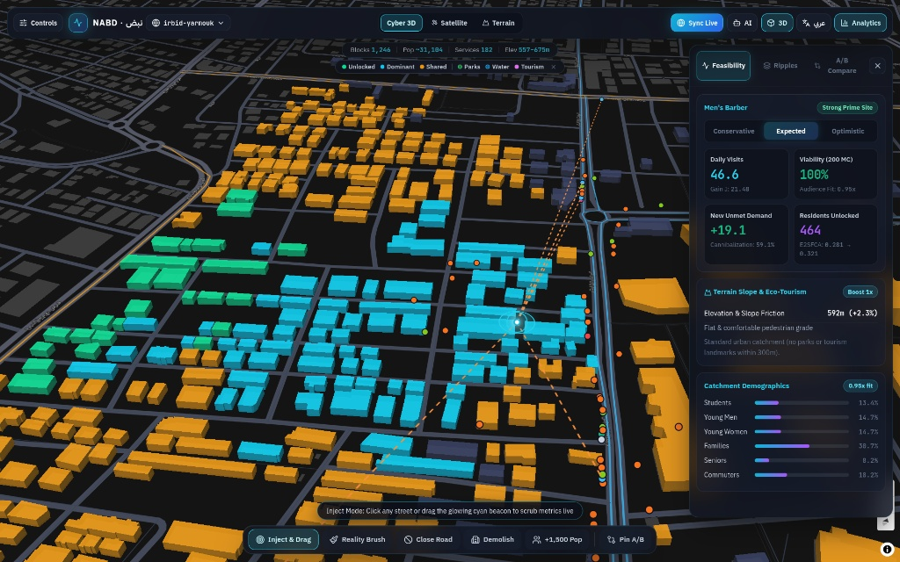
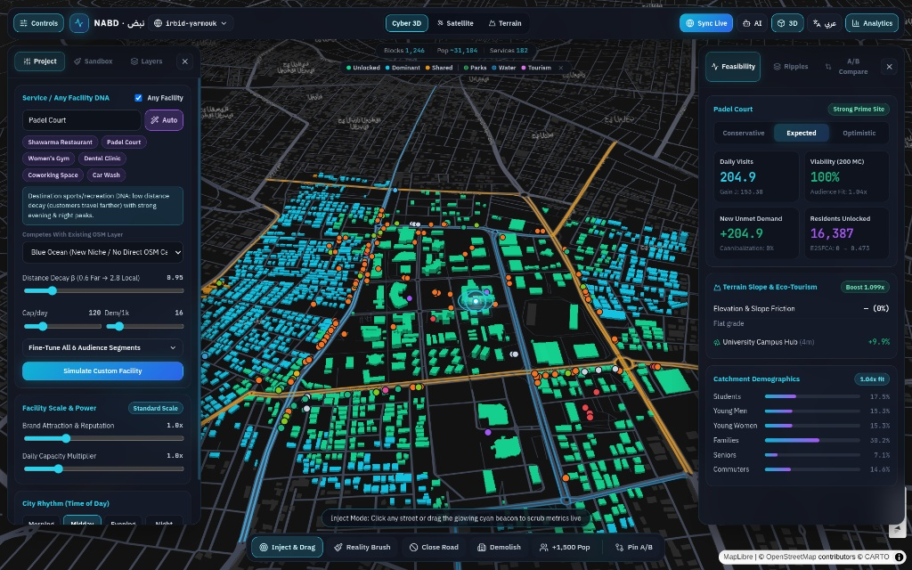
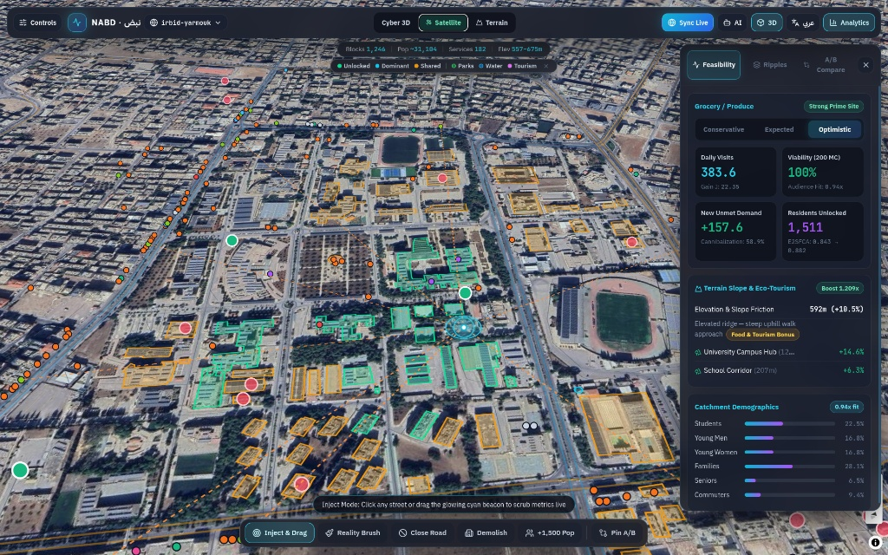

# NABD (نبض) — Constructive Urban Physics & Multi-Hop Spatial Simulation

> **Live 3D Studio:** [https://nabd-1-0pxz.onrender.com/](https://nabd-1-0pxz.onrender.com/)  
> **Forecasting cities by building, not only by breaking.**  
> A real-time 3D urban physics studio, transactional `Relate` graph engine, and grounded AI strategist that simulates how injecting **any** new business or public facility ripples across real street topologies, terrain slopes, 3D parcels, ecosystems, and competing services.


---

## 1. The Core Thesis: Why Constructive Forecasting?

Many graph-database and resilience tools focus predominantly on **destructive cascades** — asking what fails when a road is severed, a bridge collapses, or a node is removed. While stress-testing failure matters (and Nabd includes a full live crisis sandbox for road closures and building demolitions), cities are primarily shaped by **constructive decisions**: *What happens to a neighborhood's living equilibrium when we build a clinic, open a barber shop, launch a bakery, or introduce a padel court?*

Answering that question rigorously is impossible with flat straight-line radius circles or generic LLM prompting. A new facility does not exist in a vacuum — it triggers a **4-hop graph cascade**:

1. **Hop 1 — Access & Gravity:** Who can actually walk there along real streets and real elevation slopes, and is that demand *genuinely new* or merely pulled from existing neighbors?
2. **Hop 2 — Competitive Cannibalization:** Which specific existing businesses lose visits, and by what percentage?
3. **Hop 3 — Induced Ecosystem Synergy:** What secondary demand deficits does the new facility *create* around it (e.g., a clinic inducing pharmacy demand, or a campus hub inducing stationery and cafe deficits)?
4. **Hop 4 — Congestion & Uncertainty:** At what load does the facility or adjacent street hit non-linear queuing/traffic delay, and how robust is the site across 200 stochastic worlds?


---

## 2. Epistemic Humility & Human-in-the-Loop Design

No spatial model knows everything about a street. OpenStreetMap data is remarkably rich in dense districts, yet can miss newly opened shops, unmapped student dormitories, informal commercial corridors, rent economics, or cultural nuances in rapidly growing cities.

Nabd is built around **epistemic humility**: mathematical physics should **amplify local human judgment, never pretend to replace it**:

- **Uncertainty Envelopes, Never False Point-Precision:** Every injection runs **200 Monte Carlo worlds** varying population density, distance sensitivity ($\beta$), and attraction to report **Conservative (P10)**, **Expected (P50)**, and **Optimistic (P90)** scenarios alongside a viability probability.
- **Participatory Reality Brush:** People who live on the ground know where student housing, family neighborhoods, or commercial hubs actually sit. Users paint local demographic truth directly onto 3D blocks and watch the equations recalibrate in milliseconds.
- **Universal Facility DNA Synthesizer:** Users are not restricted to preset categories — type **any facility in Arabic or English** (*Padel Court, Shawarma Restaurant, Women's Gym, Dental Clinic, Coworking Space...*), synthesize its grounded economic physics (distance decay, daily capacity, 6-segment audience profile, time-of-day rhythm, and OSM competitor mapping), fine-tune every slider, and optimize across the city graph.

---

## 3. The 7 Laws of Urban Physics (Equations & Scientific Heritage)

Every calculation inside `backend/engine/physics.py` and `backend/engine/terrain_env.py` is grounded in established urban-economics and operations-research formulations:

| Law | Phenomenon Modeled | Scientific Pioneers | Mathematical Formulation in Nabd |
| :--- | :--- | :--- | :--- |
| **Law 1** | **Topological Accessibility, Circuity & Asymmetric Terrain Slope** | **Edsger W. Dijkstra** (1959) · **Waldo R. Tobler** (1993) | Directed street-graph shortest paths weighted by Tobler's hiking speed ratio normalized to flat ground: $r(s) = \exp\!\left(-3.5\left(\lvert s + 0.05\rvert - 0.05\right)\right)$, where uphill slopes penalize pedestrian reach more than gentle downhills. Exposes **Topological Illusions** where circuity $CI = d_{\text{network}} / d_{\text{euclid}} \ge 1.6$. |
| **Law 2** | **Competitive Spatial Gravity & Outside Option** | **William J. Reilly** (1931) · **David L. Huff** (1963) | $$P_{ij} = \frac{A_j^\alpha \, T_{ij}^{-\beta}}{\sum_{k} A_k^\alpha \, T_{ik}^{-\beta} + U_0}$$ The outside option $U_0$ cleanly separates **new unmet demand captured** from **competitor cannibalization**. |
| **Law 3** | **Spatial Equity & Floating Catchment Supply-Demand (E2SFCA)** | **John Radke & Lan Mu** (2000) · **Wei Luo & Yi Qi** (2009) | Two-step floating catchment with Gaussian decay $W(t)=\exp(-(t/t_{\text{ideal}})^2)$ measuring supply-to-demand ratio $R_j = C_j / \sum_i D_i W_{ij}$ and spatial equity $E_i = \sum_j W_{ij} R_j$ before and after injection, plus exact residents newly unlocked within ideal walking time. |
| **Law 4** | **Multi-Hop Induced Inter-Sectoral Synergy (Hop 3)** | **Wassily Leontief** (1936; Nobel Prize 1973) | Traverses `(:ServiceType)-[:SYNERGIZES_WITH]->(:ServiceType)` edges in `Relate` to compute cross-category induced visits $D^{\text{ind}}_b = 0.65 \, V_a \, m_{a \to b}$ minus distance-decayed nearby spare capacity $\sum_s 0.35 C_s e^{-\gamma t_s}$, flagging emerging secondary deficits. |
| **Law 5** | **Non-Linear Capacity & Street Congestion (Hop 4)** | **U.S. Bureau of Public Roads — BPR** (1964) | $$t_{\text{eff}} = t_0 \left[1 + 0.15 \left(\frac{V}{C}\right)^4\right]$$ Captures sharp non-linear queuing and adjacent-street delay spikes once utilization crosses $85\%\text{–}90\%$. |
| **Law 6** | **Constrained Spatial Optimization & Eco-Zoning Guardrails** | **Alfred Weber** (1909) · **S. Louis Hakimi** (1964) | Scans candidate junctions to maximize composite network gain $J$ while strictly penalizing/excluding restricted zoning polygons (**waterways, wetlands, public parks, cemeteries**) and applying proximity multipliers for **parks, waterfronts, tourism landmarks, universities, and schools**. |
| **Law 7** | **Stochastic Uncertainty & Viability Envelope** | **Stanislaw Ulam, John von Neumann & Nicholas Metropolis** (1940s) | Runs $N=200$ perturbed worlds sampling population ($\sigma=14\%$), decay ($\sigma=0.22$), and attraction ($\sigma=15\%$) to emit **P10 / P50 / P90** bounds and viability probability. |

---

## 4. Transactional `Relate` Graph Core & Glass-Box Inspection

All spatial state, 3D parcel metadata, service synergies, and decision history live inside indexed single-file `Relate` (`.rl`) stores managed by `backend/relate_core/`:

- **Zero-Mutation What-If Transactions (`ROLLED_BACK` in ~1–2 ms):** Every map click or live beacon drag opens a real ACID transaction against the `.rl` store, queries 3D parcel context (floors, gross floor area, buildable suitability, 2-hop neighbors and competitors), and rolls back cleanly so rapid exploration never mutates the underlying urban graph.
- **Persistent Decision Memory & Parcel Governance (`COMMITTED`):** Confirmed site evaluations and parcel ownership locks commit directly into the `.rl` graph, giving planners and AI agents auditable per-parcel history.
- **Glass-Box Inspector:** Built directly into the 3D Studio to expose live Cypher execution traces (`ROLLED_BACK` / `COMMITTED` status and latency), a safe read-only **Cypher Console**, and **Agent Decision Memory**. Reproducible audit queries are also provided in `scripts/cypher/`.

### Pre-Built Indexed Urban Graphs

| City Bundle (`.rl`) | Relate Nodes | Active Indexes | 3D Blocks | Est. Population | OSM Services | Integrity Artifacts |
| :--- | :---: | :---: | :---: | :---: | :---: | :--- |
| **`irbid-yarmouk.rl`** (Irbid, Jordan) | `2,563` | `13` | `1,246` | `~36,455` | `182` | `.build-receipt.json` · `.sha256` |
| **`manhattan-midtown.rl`** (NYC, USA) | `5,206` | `13` | `1,297` | `~90,412` | `622` | `.build-receipt.json` · `.sha256` |

---

## 5. Empirical Contrasts & Studio Visuals

Two real runs captured directly from the engine showing how Nabd distinguishes saturated traps from genuine urban gaps:

| Metric | Case A: Saturated Red Ocean (**Soho, London** · 400m) | Case B: Constructive Blue Ocean (**Yarmouk District, Irbid** · 750m) |
| :--- | :--- | :--- |
| **Injected Facility** | Men's Barber (`Standard Scale`, Midday) | Custom Synthesized **Padel Court** ($\beta=0.95$, Cap `120`/day) |
| **Projected Daily Visits (P50)** | `24.1` visits/day | `208.5` visits/day *(exceeds 1-court cap → signals room for 2+ courts)* |
| **New Unmet Demand Captured** | **`+0.5`** visits/day | **`+208.5`** visits/day |
| **Competitor Cannibalization** | **`98.1%`** *(red-ocean price war)* | **`0.0%`** *(pure blue-ocean gap)* |
| **Residents Newly Unlocked** | `0` (`E2SFCA: 1.278 → 1.288`) | **`19,214`** (`E2SFCA: 0 → 0.473`) |
| **Composite Network Gain ($J$)** | **`-20.53`** — *Saturated / Weak* | **`+154.26`** — *Strong Prime Site (`100%` MC Viability)* |

### Live Studio Visual Highlights

| Zero-Clash 3-Tier Gravity Wave (Unlocked · Dominant · Shared) | Universal Facility DNA — Blue Ocean (Custom Padel Court) |
| :---: | :---: |
|  |  |
| **Holographic Satellite Roofs & Eco-Proximity Boost** | **Topographic Terrain & Grounded AI Strategist (Optimal School Site)** |
|  |  |

---

## 6. Grounded Multi-Hop AI: `MCP Server` (11 Tools) + Hybrid Strategist

Standard LLMs cannot compute shortest paths on a street graph or evaluate coupled Huff–E2SFCA–BPR integrals — when asked *"Where should I open a cafe?"*, they guess. Nabd enforces a **Physics-First, Language-Second** architecture:

1. **In-App Universal Hybrid Strategist (`/api/area/{slug}/chat`):**
   - Runs locally with **zero API key** by executing the 7 Laws, flying the 3D camera to optimal sites, and briefing the user from verified metrics.
   - Optional plug-and-play router supporting **Google Gemini, OpenAI, Anthropic Claude, DeepSeek, Groq, OpenRouter, and Ollama**, injecting `GROUND_TRUTH_PHYSICS` into every turn.
2. **Model Context Protocol Server (`backend/mcp/server.py`, MCP SDK 2.x — 11 Grounded Tools):**
   - **Discovery & Live Sync:** `list_areas_and_services` · `sync_live_area`
   - **Physics & Site Optimization:** `simulate_urban_injection` · `detect_topological_illusions` · `find_optimal_sites` · `compare_two_locations`
   - **Relate Graph & Decision Memory:** `run_relate_cypher_readonly` *(strict read-only regex guardrail)* · `record_agent_decision` · `get_site_decision_history` · `set_parcel_ownership_status` · `get_relate_live_trace`

```json
{
  "mcpServers": {
    "nabd-urban-physics": {
      "command": "/path/to/nabd/.venv/bin/python",
      "args": ["-m", "backend.mcp.server"],
      "cwd": "/path/to/nabd"
    }
  }
}
```

---

## 7. Key Studio Features

- **Global Live Sync (Any City on Earth):** Search any city (`Manhattan`, `London`, `Tokyo`, `Amman`, `Irbid`), choose a capture radius (`400m–2.5km`), and build a fresh indexed `Relate` (`.rl`) graph with real streets, 3D buildings, DEM elevations, and environmental zones.
- **Three Purpose-Built Map Modes:** **Cyber 3D** (extruded parcels and gravity waves), **Satellite Hologram** (translucent footprints over imagery), and **Topographic Terrain** (slope-colored street segments).
- **3D Volumetric Day/Night Pulse & Guided Proof Flights (`Ctrl+K`):** Toggle between daytime commercial activity and nighttime residential gravity, or jump directly into guided multi-city scenarios via the command palette.
- **Live Drag Scrubbing, A/B Comparison & Crisis Sandbox:** Drag the glowing cyan beacon meter-by-meter along any street for live KPI updates, pin **Site A vs. Site B**, paint demographic zones, close roads, demolish 3D blocks, or inject `+1,500` population surges.
- **Bilingual (`EN / العربية`) & Cross-Device Ready:** One-click `LTR / RTL` switching, properly shaped Arabic RTL map labels (`setRTLTextPlugin`), and responsive desktop and mobile HUD controls.

---

## 8. Quick Start, Docker & Automated Verification

### Live Deployment
Open **[https://nabd-1-0pxz.onrender.com/](https://nabd-1-0pxz.onrender.com/)** directly in your browser *(public demo runs in ephemeral mode with `POST /api/demo/reset`; free-tier cold start takes ~30s after inactivity)*.

### Single-Container Docker (Recommended Local Run)
Bundles the React/MapLibre 3D studio, FastAPI backend, pre-built `.rl` stores, and the `relate` binary on port `7860`:

```bash
git clone https://github.com/ii8ll8iik-crypto/nabd.git nabd
cd nabd
docker build -t nabd-live:latest .
docker run -p 7860:7860 nabd-live:latest
```
Open **`http://127.0.0.1:7860`**.

### Local Developer Mode
Requires Python `3.11+`, Node.js `20+`, and the `relate` binary (included at `bin/relate` for Linux x86_64 or on your `PATH`):

```bash
python3 -m venv .venv && source .venv/bin/activate
pip install -r requirements.txt
(cd frontend && npm install)
./run.sh
```
Backend runs on `http://127.0.0.1:8001` and 3D Studio on `http://localhost:5173`.

### Automated Verification (`pytest` & ACID Transaction Check)
```bash
source .venv/bin/activate
python3 -m pytest -v
# 16 passed

python3 scripts/verify_relate_transactions.py
```

---

## 9. Project Structure

```text
nabd/
├── Dockerfile                        # Multi-stage unified container (Node 20 + Python 3.12 + Relate)
├── bin/relate                        # Bundled Relate Linux x86_64 binary
├── backend/
│   ├── relate_core/
│   │   ├── schema.py                 # Relate node/edge schema & 13-index definitions
│   │   ├── builder.py                # Deterministic OSM/DEM -> indexed .rl builder + SHA-256 receipts
│   │   └── client.py                 # ACID transaction runner (ROLLBACK/COMMIT) & live trace buffer
│   ├── engine/
│   │   ├── catalog.py                # Service DNA parameters, audience weights & synergy matrix
│   │   ├── ingest.py                 # Live OpenStreetMap ingestion pipeline
│   │   ├── terrain_env.py            # DEM elevations, Tobler slope physics & eco-zoning guardrails
│   │   ├── dna_synthesizer.py        # Universal Facility DNA synthesizer (local + LLM)
│   │   └── physics.py                # Core 7-Law Urban Physics kernel (NumPy/SciPy + Relate)
│   ├── api/
│   │   ├── server.py                 # FastAPI REST endpoints, ephemeral demo mode & static SPA serving
│   │   └── ai_strategist.py          # Grounded Hybrid AI strategist & universal LLM router
│   └── mcp/
│       └── server.py                 # MCP Server (SDK 2.x) exposing 11 grounded tools
├── frontend/src/
│   ├── App.tsx                       # MapLibre 3D studio, RTL plugin, day/night pulse & drag scrubbing
│   ├── api.ts & types.ts             # Strict TypeScript API client & domain contracts
│   ├── i18n.ts                       # Full EN / AR bilingual dictionary & quick cities
│   └── components/                   # TopBar, ControlDrawer, TelemetryDrawer, ToolRail,
│                                     # RelateInspectorPanel, CommandPalette, AiStrategistPanel
├── scripts/
│   ├── cypher/                       # 4 auditable Relate Cypher queries (store health, parcels, memory)
│   └── verify_relate_transactions.py # Live ACID COMMIT/ROLLBACK verification script
├── tests/                            # 16 automated tests (physics, Relate core, API & MCP)
├── data/                             # Indexed irbid-yarmouk.rl & manhattan-midtown.rl + receipts/SHA-256
├── docs/                             # Architecture diagrams (SVG/PNG) & studio screenshots
├── LICENSE & NOTICE
└── run.sh
```

---

## 10. Honest Limitations & Future Roadmap

In keeping with epistemic humility, we explicitly note current boundaries and next engineering milestones:

1. **Population Proxy Variance:** Without proprietary census micro-data, residential population is estimated from OSM building footprints and floor levels; areas with incomplete OSM building heights benefit from local calibration via the Reality Brush or `+1,500 Pop` tool.
2. **Pedestrian-First Network Model:** Current routing models directed walking with Tobler slope physics; integrating multimodal public transit (GTFS) and turn-restricted vehicular networks is the next core physics layer.
3. **Economic & Rent Layers:** Demand volume and cannibalization are modeled rigorously, while unit-economics inputs (commercial rent per $m^2$, average ticket size, staffing cost) are planned as an optional financial-ROI overlay.
4. **Commercial Tile Licensing:** Development uses public tile endpoints for rapid prototyping; production deployments swap cleanly to licensed Mapbox / Google Map Tiles API keys via a single configuration line.

---

*Built with mathematical discipline, respect for local urban knowledge, and transactional `Relate` graph architecture.*
